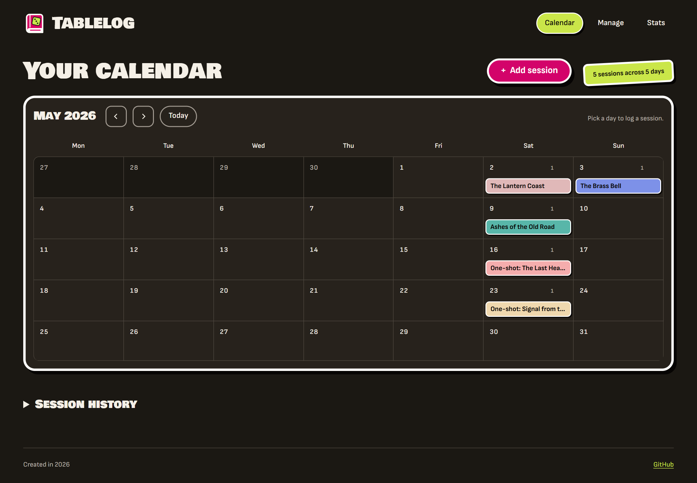
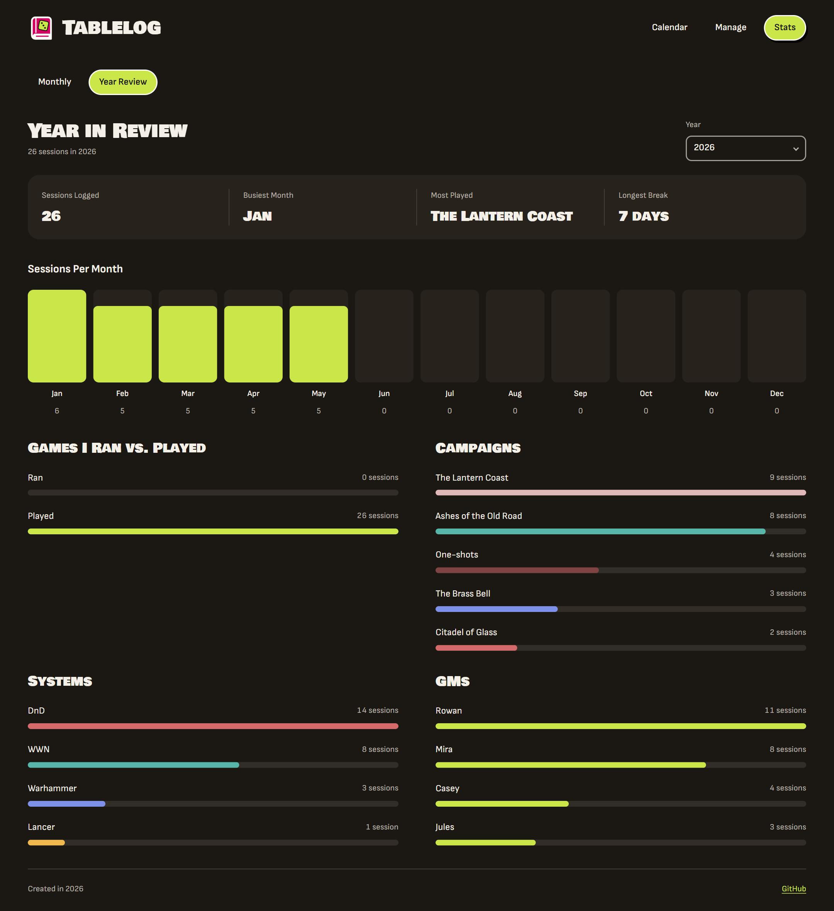

# Tablelog

Tablelog is a self-hosted web app for tracking tabletop role-playing game (TTRPG)
sessions, campaigns and play statistics. It brings a session calendar, searchable
history and game records into one place.

This is a personal quality assurance (QA) and business analysis (BA) portfolio
project. The idea is mine, inspired by Notion add-ons that support similar
tracking tasks.

The app and its documentation were created with help from Claude and Codex.
I make product decisions, develop the app and carry out the manual testing.

## Preview

<a href="docs/images/tablelog-calendar.png"></a>

<a href="docs/images/tablelog-statistics.png"></a>

Both previews use the same fictional starter data included with new installations:
26 sessions with invented campaign titles and GM names. Select an image to view
it at full size.

## Features and project status

- Log campaign sessions and one-shots with dates, GMs, game systems, links and notes.
- Browse a calendar and search or filter session history.
- Manage campaigns, session defaults and game-system colors.
- Review monthly and yearly play statistics.
- Preview CSV imports and export tracker data to CSV.

**Status:** Working personal project under active development. The app currently
uses one shared dataset per installation, with no user accounts. QA/BA
documentation is in progress; the [documentation checklist](docs/portfolio/README.md)
tracks the next steps.

## Getting started

Install Git, then download the project:

```powershell
git clone https://github.com/AnnaBalah/ttrpg_planner.git
cd ttrpg_planner
```

New installations include 26 fictional sessions. To start empty, follow the
[guide to your data and demo sessions](docs/data-and-backups.md) before launching
the app. It also explains how to save a copy of your games or start over.

**Run with Python:** Install Python 3.13 or newer and
[uv](https://docs.astral.sh/uv/getting-started/installation/). From the repository
root, run:

```powershell
cd ttrpg_tracker/app
uv run uvicorn main:app --reload
```

**Or run with Docker:** Install Docker with Compose. From the repository root,
run:

```powershell
cd ttrpg_tracker
docker compose up -d
```

Open [http://localhost:8000](http://localhost:8000) in your browser. To explore the
demo records, select a month between January and May 2026.

- **Manage:** Add game systems and campaigns, set session defaults, or export and
  preview imports of tracker CSV files.
- **Calendar:** Choose **Add session** or select a day to record a campaign session
  or one-shot. Expand **Session history** to search, filter or edit records.
- **Stats:** Explore **Monthly** statistics or **Year Review** for the selected
  period.

Stop the Python server with `Ctrl+C`. For Docker, run `docker compose stop` from
the `ttrpg_tracker` directory.

## Documentation and testing

- [QA/BA documentation](docs/portfolio/README.md): a checklist and short
  placeholders for the analysis, testing and case study.
- [Automated checks](ttrpg_tracker/app/README.md#verification): setup and
  commands for the existing backend and browser checks.
- [Your data and demo sessions](docs/data-and-backups.md): storage, backups,
  recovery and starting with an empty tracker.

Tablelog uses Python with FastAPI, SQLModel and SQLite, plus HTML, CSS and
JavaScript. Dependencies are managed with uv. For local development, follow the
Python setup in [Getting started](#getting-started).
