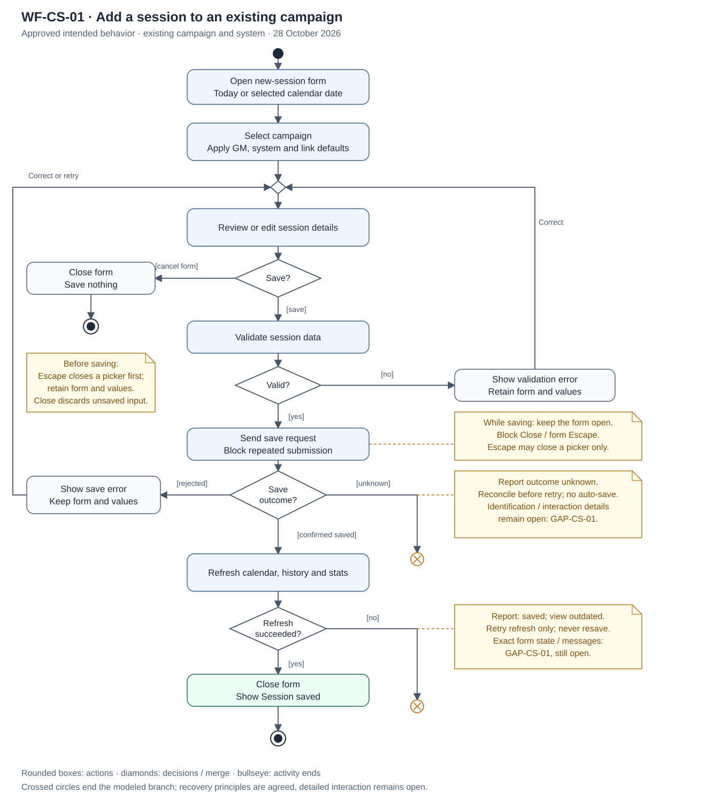

# Process and data models

**Status:** Draft activity diagram for campaign-session entry. The data model is
still planned. Keep each new model in a collapsed section.

<strong>WF-CS-01: Add a session to an existing campaign — UML activity diagram</strong>

This diagram shows the order of actions, decisions and retry paths for the
[workflow](requirements-and-rules.md#wf-cs-01-add-a-session-to-an-existing-campaign).
It covers an existing campaign and system, with optional session overrides.

[Open the editable SVG at full size](../diagrams/campaign-session-activity.svg).

**Draft boundary:** Orange notes mark GAP-CS-01. The crossed circles end the
documented branches where recovery is undefined; they do not prescribe how the
app should recover. The rejected-save branch assumes no session was created.
The confirmed-save branch follows the reviewed handler's
order: close the form, then refresh. Closing while saving, picker Escape behavior,
same-day sessions and API defaults remain
[follow-up actions](requirements-and-rules.md#campaign-session-follow-up).

The diagram summarizes the [acceptance criteria](acceptance-criteria.md); it is
not test evidence. Activity-diagram notation uses actions, guarded decisions and
start/end nodes; see the [PlantUML notation examples](https://plantuml.com/activity-diagram-beta).

<strong>Data model — planned</strong>

Create a small diagram of systems, campaigns and sessions, showing required and
optional relationships. This remains separate from the activity diagram above.

**Related documents:**

[Requirements and rules](requirements-and-rules.md) ·
[Acceptance criteria](acceptance-criteria.md) · [Test records](test-records.md) ·
[Documentation checklist](README.md)
