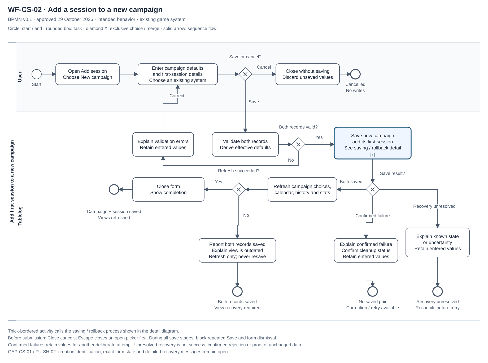
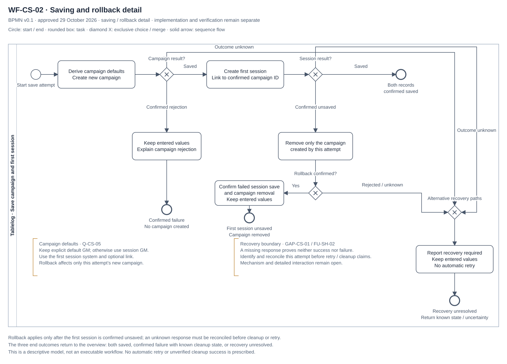
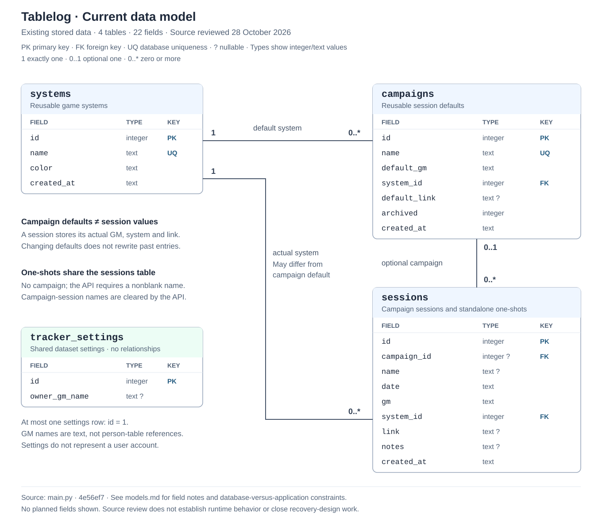

# Process and data models

**Status:** Current data model and WF-CS-01 UML activity diagram approved on
28 October 2026 within their stated scope and boundaries. The current data model
documents all 22 stored fields across four tables. WF-CS-02 BPMN version 0.1 was
approved on 29 October 2026 within its stated scope. Detailed recovery design
remains open under GAP-CS-01 / FU-SH-02.
Keep each model in a collapsed section.

<strong>WF-CS-01: Add a session to an existing campaign — UML activity diagram</strong>

**Status:** Approved on 28 October 2026 as a model of the agreed intended behavior,
within the boundary below.

This diagram shows the order of actions, decisions and retry paths for the
[workflow](requirements-and-rules.md#wf-cs-01-add-a-session-to-an-existing-campaign).
It covers an existing campaign and system, with optional session overrides.

[Open the editable SVG at full size](../diagrams/campaign-session-activity.svg).

**Approval boundary:** The diagram models agreed intended browser-form behavior.
After a confirmed save, a successful refresh precedes closing the form and showing
normal success feedback. A failed refresh must not repeat the save; an unknown
save outcome requires reconciliation before retry. Orange notes distinguish
these agreed principles from the creation-request identification, precise form
state and workflow-specific messages still open under GAP-CS-01 / FU-SH-02.
The crossed circles end the modeled branches at that boundary. The rejected-save
branch assumes no session was created and retains the form and values for retry.
Escape and pending-save protection reflect Q-CS-07. Same-day entries and API
defaults are agreed in Q-CS-06/08; implementation and verification remain separate
[follow-up actions](requirements-and-rules.md#campaign-session-follow-up).

The diagram summarizes the [acceptance criteria](acceptance-criteria.md); it is
not test evidence. Activity-diagram notation uses actions, guarded decisions and
start/end nodes; see the [PlantUML notation examples](https://plantuml.com/activity-diagram-beta).

<strong>WF-CS-02: Add a session to a new campaign — BPMN process</strong>

**Status:** Version 0.1, prepared 28 October 2026; approved by the owner on
29 October 2026 within its stated scope and recovery boundary.
**Model type:** Agreed intended behavior. The owner selected the main path plus
validation, cancellation and save failures, including rollback, using an existing
game system. Creating a system is a separate workflow.

**Process:** The user opens Add session, chooses New campaign and enters the
campaign defaults and first-session values. Tablelog validates both records,
creates the campaign, then saves its first linked session. Completion follows
confirmation of both records and successful refresh.

**Main process — User and Tablelog lanes**

[Open the overview SVG](../diagrams/new-campaign-session-bpmn.svg).

**Saving and rollback detail — called process**

[Open the detail SVG](../diagrams/new-campaign-session-bpmn-detail.svg) ·
[Editable BPMN 2.0 source with both views](../diagrams/new-campaign-session.bpmn).

The overview uses one pool with User and Tablelog lanes. Generic tasks show work;
exclusive gateways select one alternative. A thick-bordered call activity opens
the saving/rollback process. Both views share the native `.bpmn` source.
They are descriptive and non-executable. Notation reference:
[OMG BPMN 2.0.2](https://www.omg.org/spec/BPMN/2.0.2/PDF).

| Part of the process | Approved basis |
| --- | --- |
| Entry and campaign defaults | FR-CS-20–21; Q-CS-05; AC-CS-24–25. Explicit default GM takes precedence; otherwise use session GM. Session system and optional link become initial campaign defaults. |
| Validation and correction | FR-CS-21; FR-SH-02; AC-CS-26. Invalid inputs create neither record; retain values for correction. |
| Saving and cancellation | FR-CS-22; FR-SH-03/06; AC-CS-27; AC-SH-03/05/09–10. Cancel before submission writes nothing. Keep the form open and block repeated submission through every pending save stage. Escape may close a picker only. |
| Failure and rollback | FR-CS-23; Q-CS-04; AC-CS-28–29; AC-SH-08. Roll back only this attempt's campaign after the first session is confirmed unsaved. Unknown outcomes or unconfirmed cleanup require reconciliation before retry or cleanup-success claims. |
| Completion and refresh | FR-CS-24; FR-SH-05; AC-CS-30; AC-SH-06–07. Confirm success only for the saved pair after refresh. A failed refresh requires view recovery without another write. |

**Modeled outcomes:** Both records saved; confirmed failure with known stored
state; or unresolved recovery. Failure ends this depicted save attempt with values
available for another deliberate attempt. An unresolved end is not successful
completion, proof of unchanged data or permission to retry blindly. Creation
identification, detailed reconciliation, failed-cleanup interaction and exact
messages remain GAP-CS-01 / FU-SH-02; these diagrams do not invent their solution.

**Implementation boundary:** The current frontend saves the campaign and session
in separate requests without the agreed rollback. Adding these diagrams does not
implement rollback or establish a passed test. See
[WF-CS-02](requirements-and-rules.md#wf-cs-02), the campaign-plus-first-session
criteria AC-CS-24–30 in [Acceptance criteria](acceptance-criteria.md),
and FU-CS-05 in the [follow-up register](requirements-and-rules.md#workflow-follow-up).

<strong>Moving a process model from draft to approved</strong>

Approval means that a named model accurately represents its agreed scope.
It does not certify the implementation or require a passed runtime test cycle.
An explicitly bounded model can be approved while recovery-design work remains
open, if the owner accepts those limits.

For the new BPMN model:

1. [x] **Confirm scope:** Intended behavior, new campaign and its first session,
   existing game system, including cancellation and failure paths.
2. [x] **Align the flow:** Link the approved requirements and criteria; distinguish
   confirmed rejection, unknown outcomes and failed refresh.
3. [x] **State the limits:** Preserve GAP-CS-01 / FU-SH-02 and separate model
   approval from implementation, rollback completion and test execution.
4. [x] **Check the artifacts:** Review notation, labels, flow connections,
   native BPMN references, layout and document links.
5. [x] **Owner review and approval:** The owner approved version 0.1, including both
   BPMN views, within the stated scope on 29 October 2026: “Approve within the
   stated scope.” The documented recovery boundary is retained; implementation
   and test-execution tasks remain open.

The current data model and WF-CS-01 activity diagram already have approval
recorded on 28 October 2026. Their stated recovery and implementation boundaries
remain in force. The separate approval of BPMN version 0.1 on 29 October 2026
completes FU-CS-06. GAP-CS-01 / FU-SH-02 recovery details, FU-CS-05 rollback
implementation and runtime verification remain open.

<strong>Current data model — entities, fields and relationships</strong>

**Status:** Approved on 28 October 2026 as documentation of the existing stored
data model.

**Scope:** Existing stored data only. Reviewed on 28 October 2026 against
[the table definitions and API handlers](../../ttrpg_tracker/app/main.py) at
`4e56ef7`. This is source documentation, not runtime test evidence. Planned
additions such as players present are outside this model.

[Open the editable SVG at full size](../diagrams/current-data-model.svg).

**Notation:** PK = primary key; FK = foreign key; UQ = database uniqueness;
`?` = nullable. Integer and text describe the values the app is designed to save.
SQLite uses flexible typing in these tables, so the type labels alone do not
guarantee those values. Some restrictions are checked by the app. Relationship
numbers describe how many records may be linked at each end.

| Relationship | Meaning |
| --- | --- |
| `systems` 1 → 0..* `campaigns` | Each campaign requires one default system. A system can have no campaigns or many. |
| `systems` 1 → 0..* `sessions` | Each session requires one actual system, independently of its campaign's default. A system can have no sessions or many. |
| `campaigns` 0..1 → 0..* `sessions` | A campaign can have no sessions or many. A session references at most one campaign; a one-shot has none. |
| `tracker_settings` — independent | At most one row, with `id = 1`; no foreign keys or user-account relationship. |

<strong>Stored fields</strong>

**`systems` — reusable game systems**

| Field | Value type | Nullable | Meaning / constraint |
| --- | --- | --- | --- |
| `id` | integer | No | Generated PK. |
| `name` | text | No | System name; database uniqueness plus normalized application checks. |
| `color` | text | No | Primary color; the API requires six-digit `#RRGGBB`. Derived shades are not stored. |
| `created_at` | text | No | Creation timestamp; defaults to application-generated UTC time. |

**`campaigns` — reusable session defaults**

| Field | Value type | Nullable | Meaning / constraint |
| --- | --- | --- | --- |
| `id` | integer | No | Generated PK. |
| `name` | text | No | Campaign name; database uniqueness plus normalized application checks. |
| `default_gm` | text | No | Starting GM name for a new campaign session; free text. |
| `system_id` | integer | No | FK → `systems.id`; default system for new sessions. |
| `default_link` | text | Yes | Optional starting link offered by the browser form. |
| `archived` | integer | No | The app marks new campaigns as active (`0`) automatically; SQLite has no default for this field. The API permits `0` (active) or `1` (archived). Archiving retains sessions. |
| `created_at` | text | No | Creation timestamp; defaults to application-generated UTC time. |

**`sessions` — campaign sessions and standalone one-shots**

| Field | Value type | Nullable | Meaning / constraint |
| --- | --- | --- | --- |
| `id` | integer | No | Generated PK; separate deliberate sessions have separate IDs. |
| `campaign_id` | integer | Yes | FK → `campaigns.id`; `NULL` identifies a standalone one-shot. |
| `name` | text | Yes | One-shot name; required for one-shots and cleared for campaign sessions by the API. |
| `date` | text | No | Calendar date stored as ISO `YYYY-MM-DD`; the API validates the date. No time of day. |
| `gm` | text | No | Actual GM name for this session; free text, not a reference to a person table. |
| `system_id` | integer | No | FK → `systems.id`; actual system, which may differ from the campaign default. |
| `link` | text | Yes | Optional session link; supplied links must pass HTTP/HTTPS API validation. |
| `notes` | text | Yes | Optional session notes. |
| `created_at` | text | No | Creation timestamp; defaults to application-generated UTC time. |

**`tracker_settings` — shared dataset settings**

| Field | Value type | Nullable | Meaning / constraint |
| --- | --- | --- | --- |
| `id` | integer | No | PK constrained to `1`; the row may be absent before a setting is saved. |
| `owner_gm_name` | text | Yes | My GM name used for Ran/Played statistics; may be cleared and does not rewrite session GMs. No FK. |

CSV import may preserve a supplied valid ISO `created_at` timestamp instead of
generating a new one.

<strong>Storage constraints and application rules</strong>

1. **Required references:** SQLite foreign-key enforcement is enabled for app
   connections. Campaigns and sessions require an existing system; a non-null
   session campaign reference must exist. The API blocks deleting a campaign
   that has sessions. No cascading deletion is configured.
2. **Session kind:** The database check is
   `campaign_id IS NOT NULL OR name IS NOT NULL`. The API adds the stronger rule:
   a one-shot needs a nonblank name, while a campaign session stores `name = NULL`.
   The database check alone does not enforce that distinction.
3. **Names and separate sessions:** System and campaign names are unique within
   their own tables. Application checks compare names after Unicode NFC
   normalization, trimming and case folding; database uniqueness alone is not
   that full policy. Sessions have no uniqueness constraint on campaign, date,
   GM or system: deliberate identical sessions are permitted (Q-CS-06).
4. **Defaults and recorded values:** Campaign defaults start new entries; session
   GM, system and link are stored separately. API creation can use campaign GM
   and system defaults when omitted (Q-CS-08). Changing campaign defaults does
   not rewrite recorded session values. Display labels use current referenced
   campaign/system names; colors derive from the current actual system's color.
5. **Settings and derived values:** My GM name is a shared text setting, selected
   through the API from existing GM values or the saved choice, not a user
   account or person entity. Counts, statistics, display names and color shades
   are computed; they are not additional stored fields. Record exports currently
   exclude settings; a full database backup includes them.

These notes describe the current schema and handlers. They do not settle the
open recovery design or establish that planned rollback behavior is implemented.

<strong>Fictional example — defaults and a session override</strong>

| Record | GM | System | Link |
| --- | --- | --- | --- |
| Campaign **Lantern Road**, ID 10 | Default: Morgan | Default: System A, ID 1 | Default: `https://example.com/campaign` |
| Session ID 42, campaign ID 10, date `2026-10-28` | Riley | Actual: System B, ID 2 | `https://example.com/session` |

The session counts under Lantern Road, Riley and System B. Its color follows
System B. The campaign retains its defaults; later default changes do not
replace session 42's recorded GM, system or link.

**Sources:** [Stored models and API handlers](../../ttrpg_tracker/app/main.py),
[display color derivation](../../ttrpg_tracker/app/frontend/app.js),
[campaign-session rules](requirements-and-rules.md#wf-cs-01-rules),
[one-shot rules](requirements-and-rules.md#wf-os-01-rules) and
[My GM name](requirements-and-rules.md#wf-st-03).

**Related documents:**

[Requirements and rules](requirements-and-rules.md) ·
[Acceptance criteria](acceptance-criteria.md) · [Test records](test-records.md) ·
[Documentation checklist](README.md)
