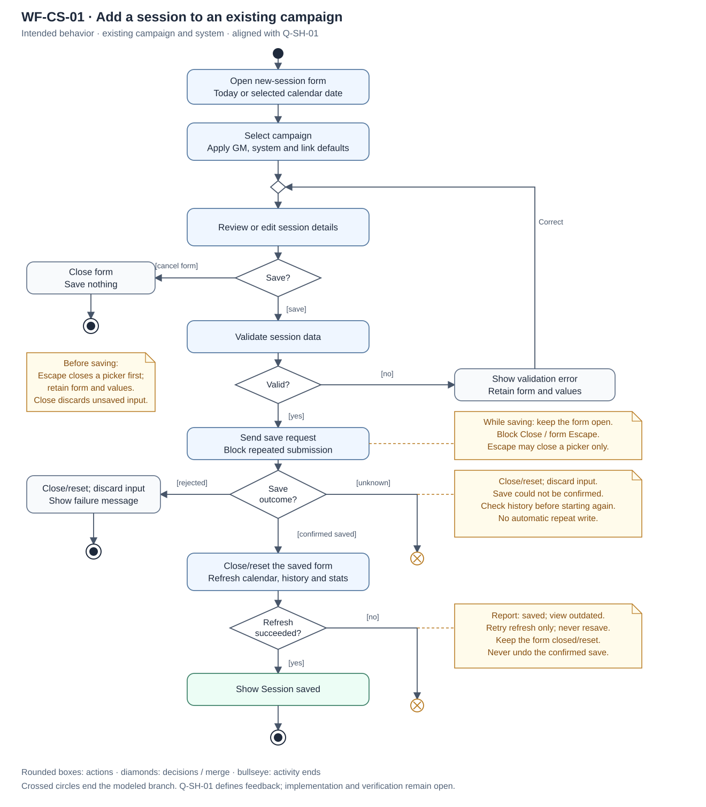
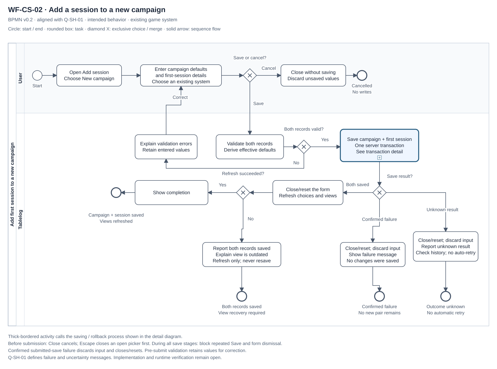
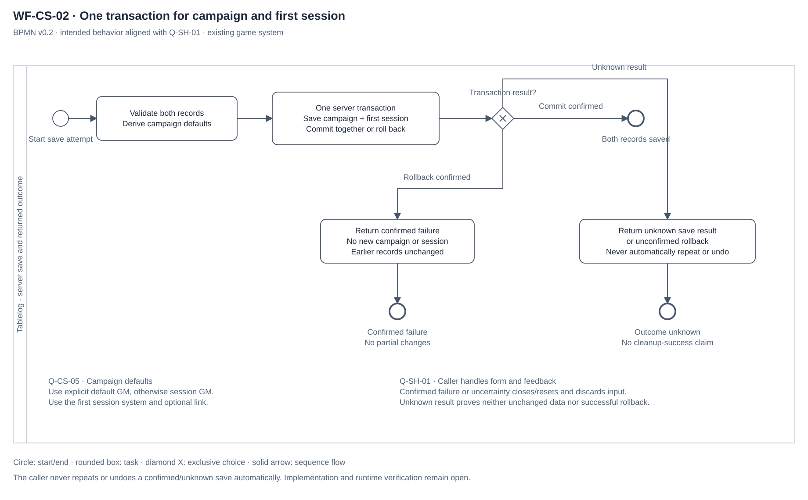
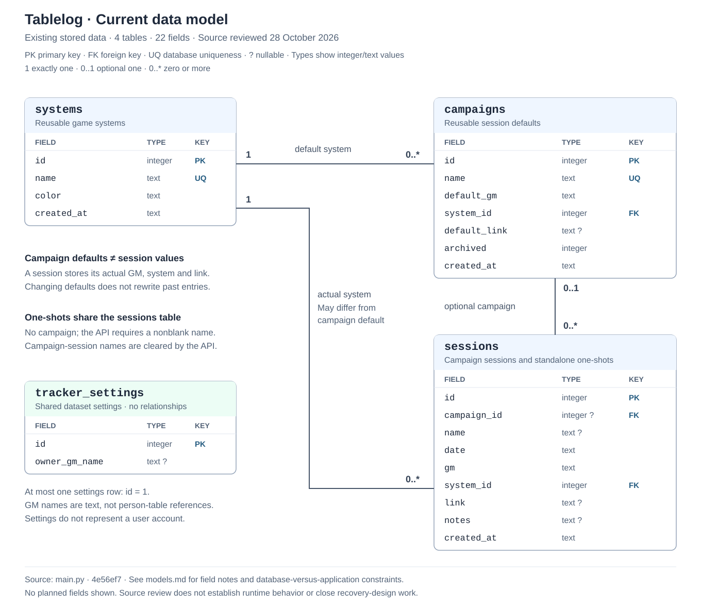

# Process and data models

**Status:** WF-CS-01 and WF-CS-02 process models are aligned with the current
[Q-SH-01 save policy](requirements-and-rules.md#shared-decisions). WF-CS-02 is
version 0.2. The earlier process-model reviews remain historical context. The
current save implementation is described below. The current data model,
approved on 28 October 2026, still documents all 22 stored fields across four tables.
Keep each model in a collapsed section.

<strong>WF-CS-01: Add a session to an existing campaign — UML activity diagram</strong>

**Status:** Intended behavior aligned with Q-SH-01. The earlier model review was
completed on 28 October 2026; this alignment is not implementation or test evidence.

This diagram shows the order of actions and outcomes for the
[workflow](requirements-and-rules.md#wf-cs-01-add-a-session-to-an-existing-campaign).
It covers an existing campaign and system, with optional session overrides.

[Open the editable SVG at full size](../diagrams/campaign-session-activity.svg).

**Model boundary:** Existing campaign and system only. Browser validation retains
input for correction. A confirmed submitted-save failure discards input and
closes/resets; a confirmed save closes/resets before refresh and completion feedback.
A failed refresh never repeats or undoes the save. An unknown result closes/resets,
explains uncertainty and directs the owner to history before starting again.
Q-SH-01 defines the messages; mandatory attempt identification and reconciliation
are outside these form saves. Escape and pending-save protection retain Q-CS-07.
Same-day entries and API defaults retain Q-CS-06/08. Implementation and verification
remain separate [follow-up actions](requirements-and-rules.md#campaign-session-follow-up).

The diagram summarizes the [acceptance criteria](acceptance-criteria.md); it is
not test evidence. Activity-diagram notation uses actions, guarded decisions and
start/end nodes; see the [PlantUML notation examples](https://plantuml.com/activity-diagram-beta).

<strong>WF-CS-02: Add a session to a new campaign — BPMN process</strong>

**Status:** Version 0.2, aligned with Q-SH-01. Version 0.1 was reviewed on
29 October 2026; its retained-form/reconciliation boundary is superseded.
**Model type:** Agreed intended behavior. The owner selected the main path plus
validation, cancellation and save failures, including rollback, using an existing
game system. Creating a system is a separate workflow.

**Process:** The user opens Add session, chooses New campaign and enters the
campaign defaults and first-session values. Tablelog validates both records and
saves them in one server transaction. Confirmed failure leaves neither new record.
Confirmed success closes/resets the form, refreshes views and then reports completion.

**Main process — User and Tablelog lanes**

[Open the overview SVG](../diagrams/new-campaign-session-bpmn.svg).

**Saving and rollback detail — called process**

[Open the detail SVG](../diagrams/new-campaign-session-bpmn-detail.svg) ·
[Editable BPMN 2.0 source with both views](../diagrams/new-campaign-session.bpmn).

The overview uses one pool with User and Tablelog lanes. Generic tasks show work;
exclusive gateways select one alternative. A thick-bordered call activity opens
the saving/rollback process. Both views share the native `.bpmn` source.
They are descriptive and non-executable. Notation reference:
[OMG BPMN 2.0.2](https://www.omg.org/spec/BPMN/2.0.2/PDF).

| Part of the process | Approved basis |
| --- | --- |
| Entry and campaign defaults | FR-CS-20–21; Q-CS-05; AC-CS-24–25. Explicit default GM takes precedence; otherwise use session GM. Session system and optional link become initial campaign defaults. |
| Validation and correction | FR-CS-21; FR-SH-02; AC-CS-26. Invalid inputs create neither record; retain values for correction. |
| Saving and cancellation | FR-CS-22; FR-SH-03/05/06; AC-CS-27; AC-SH-03/05/09–10. The pair saves in one server transaction. Cancel before submission writes nothing. Keep the form open and block repeat submission/dismissal while pending; Escape may close only a picker. |
| Failure and rollback | FR-CS-23; Q-CS-04; AC-CS-28–29; AC-SH-04/08. One server transaction protects earlier records. Confirmed failure leaves neither new record, discards input and closes/resets. Unknown results are reported without automatic repeat writes or cleanup claims. |
| Completion and refresh | FR-CS-24; FR-SH-05; AC-CS-30; AC-SH-06–07. Close/reset after a confirmed save, refresh, then report normal completion. Failed refresh reports the saved pair and outdated view without repeating or undoing the save. |

**Modeled outcomes:** Both records saved; confirmed transaction failure with no
partial changes; saved pair with an outdated view; or an unknown save/rollback
result. Submitted failure and uncertainty close/reset the form and discard input.
Only pre-submit validation returns to correction with values retained. Q-SH-01
defines exact feedback and preserves other workflows' recovery rules.

**Current implementation:** The form submits the campaign and first session in
one request. The server saves them in one transaction, including an inline new
system when supplied. The backend rollback check and the browser checks cover
different parts of this flow. See
[WF-CS-02](requirements-and-rules.md#wf-cs-02), the campaign-plus-first-session
criteria AC-CS-24–30 in [Acceptance criteria](acceptance-criteria.md),
FU-CS-05 in the [follow-up register](requirements-and-rules.md#workflow-follow-up),
and the [execution results](test-records.md#execution-results).

<strong>Current data model — entities, fields and relationships</strong>

**Status:** Approved on 28 October 2026 as documentation of the existing stored
data model.

**Scope:** Existing stored data only. Reviewed on 28 October 2026 against
[the table definitions and API handlers](../../ttrpg_tracker/app/main.py) at
`4e56ef7`. This is source documentation, not runtime test evidence. Planned
additions such as players present are outside this model.

[Open the editable SVG at full size](../diagrams/current-data-model.svg).

**Notation:** PK = primary key; FK = foreign key; UQ = database uniqueness;
`?` = nullable. Integer and text describe the values the app is designed to save.
SQLite uses flexible typing in these tables, so the type labels alone do not
guarantee those values. Some restrictions are checked by the app. Relationship
numbers describe how many records may be linked at each end.

| Relationship | Meaning |
| --- | --- |
| `systems` 1 → 0..* `campaigns` | Each campaign requires one default system. A system can have no campaigns or many. |
| `systems` 1 → 0..* `sessions` | Each session requires one actual system, independently of its campaign's default. A system can have no sessions or many. |
| `campaigns` 0..1 → 0..* `sessions` | A campaign can have no sessions or many. A session references at most one campaign; a one-shot has none. |
| `tracker_settings` — independent | At most one row, with `id = 1`; no foreign keys or user-account relationship. |

<strong>Stored fields</strong>

**`systems` — reusable game systems**

| Field | Value type | Nullable | Meaning / constraint |
| --- | --- | --- | --- |
| `id` | integer | No | Generated PK. |
| `name` | text | No | System name; database uniqueness plus normalized application checks. |
| `color` | text | No | Primary color; the API requires six-digit `#RRGGBB`. Derived shades are not stored. |
| `created_at` | text | No | Creation timestamp; defaults to application-generated UTC time. |

**`campaigns` — reusable session defaults**

| Field | Value type | Nullable | Meaning / constraint |
| --- | --- | --- | --- |
| `id` | integer | No | Generated PK. |
| `name` | text | No | Campaign name; database uniqueness plus normalized application checks. |
| `default_gm` | text | No | Starting GM name for a new campaign session; free text. |
| `system_id` | integer | No | FK → `systems.id`; default system for new sessions. |
| `default_link` | text | Yes | Optional starting link offered by the browser form. |
| `archived` | integer | No | The app marks new campaigns as active (`0`) automatically; SQLite has no default for this field. The API permits `0` (active) or `1` (archived). Archiving retains sessions. |
| `created_at` | text | No | Creation timestamp; defaults to application-generated UTC time. |

**`sessions` — campaign sessions and standalone one-shots**

| Field | Value type | Nullable | Meaning / constraint |
| --- | --- | --- | --- |
| `id` | integer | No | Generated PK; separate deliberate sessions have separate IDs. |
| `campaign_id` | integer | Yes | FK → `campaigns.id`; `NULL` identifies a standalone one-shot. |
| `name` | text | Yes | One-shot name; required for one-shots and cleared for campaign sessions by the API. |
| `date` | text | No | Calendar date stored as ISO `YYYY-MM-DD`; the API validates the date. No time of day. |
| `gm` | text | No | Actual GM name for this session; free text, not a reference to a person table. |
| `system_id` | integer | No | FK → `systems.id`; actual system, which may differ from the campaign default. |
| `link` | text | Yes | Optional session link; supplied links must pass HTTP/HTTPS API validation. |
| `notes` | text | Yes | Optional session notes. |
| `created_at` | text | No | Creation timestamp; defaults to application-generated UTC time. |

**`tracker_settings` — shared dataset settings**

| Field | Value type | Nullable | Meaning / constraint |
| --- | --- | --- | --- |
| `id` | integer | No | PK constrained to `1`; the row may be absent before a setting is saved. |
| `owner_gm_name` | text | Yes | My GM name used for Ran/Played statistics; may be cleared and does not rewrite session GMs. No FK. |

CSV import may preserve a supplied valid ISO `created_at` timestamp instead of
generating a new one.

<strong>Storage constraints and application rules</strong>

1. **Required references:** SQLite foreign-key enforcement is enabled for app
   connections. Campaigns and sessions require an existing system; a non-null
   session campaign reference must exist. The API blocks deleting a campaign
   that has sessions. No cascading deletion is configured.
2. **Session kind:** The database check is
   `campaign_id IS NOT NULL OR name IS NOT NULL`. The API adds the stronger rule:
   a one-shot needs a nonblank name, while a campaign session stores `name = NULL`.
   The database check alone does not enforce that distinction.
3. **Names and separate sessions:** System and campaign names are unique within
   their own tables. Application checks compare names after Unicode NFC
   normalization, trimming and case folding; database uniqueness alone is not
   that full policy. Sessions have no uniqueness constraint on campaign, date,
   GM or system: deliberate identical sessions are permitted (Q-CS-06).
4. **Defaults and recorded values:** Campaign defaults start new entries; session
   GM, system and link are stored separately. API creation can use campaign GM
   and system defaults when omitted (Q-CS-08). Changing campaign defaults does
   not rewrite recorded session values. Display labels use current referenced
   campaign/system names; colors derive from the current actual system's color.
5. **Settings and derived values:** My GM name is a shared text setting, selected
   through the API from existing GM values or the saved choice, not a user
   account or person entity. Counts, statistics, display names and color shades
   are computed; they are not additional stored fields. Record exports currently
   exclude settings; a full database backup includes them.

These notes describe the current schema and handlers. They do not establish that
the intended form-save behavior is implemented or verified.

<strong>Fictional example — defaults and a session override</strong>

| Record | GM | System | Link |
| --- | --- | --- | --- |
| Campaign **Lantern Road**, ID 10 | Default: Morgan | Default: System A, ID 1 | Default: `https://example.com/campaign` |
| Session ID 42, campaign ID 10, date `2026-10-28` | Riley | Actual: System B, ID 2 | `https://example.com/session` |

The session counts under Lantern Road, Riley and System B. Its color follows
System B. The campaign retains its defaults; later default changes do not
replace session 42's recorded GM, system or link.

**Sources:** [Stored models and API handlers](../../ttrpg_tracker/app/main.py),
[display color derivation](../../ttrpg_tracker/app/frontend/app.js),
[campaign-session rules](requirements-and-rules.md#wf-cs-01-rules),
[one-shot rules](requirements-and-rules.md#wf-os-01-rules) and
[My GM name](requirements-and-rules.md#wf-st-03).

**Related documents:**

[Requirements and rules](requirements-and-rules.md) ·
[Acceptance criteria](acceptance-criteria.md) · [Test records](test-records.md) ·
[Documentation checklist](README.md)
